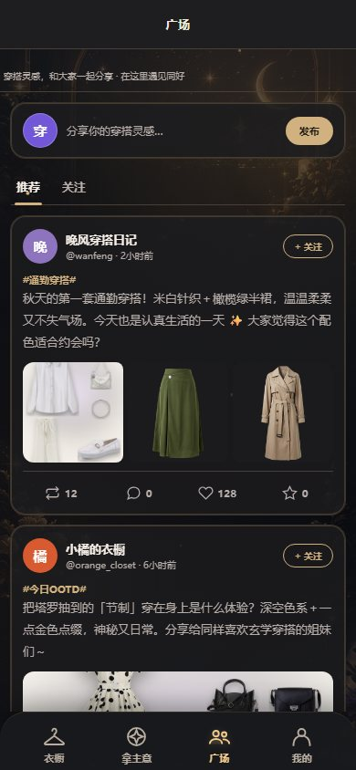
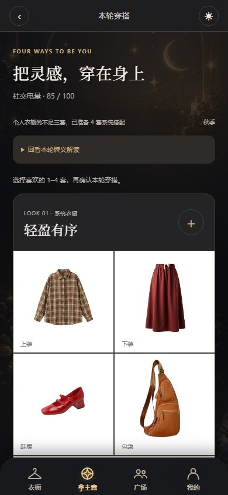
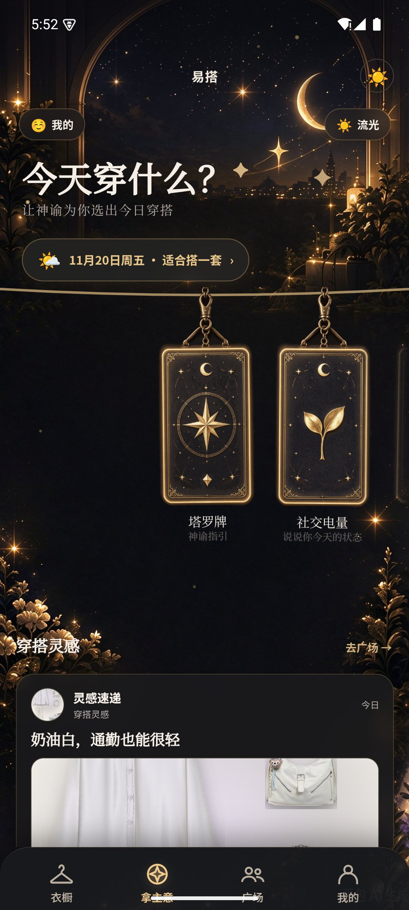
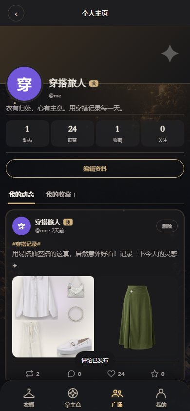
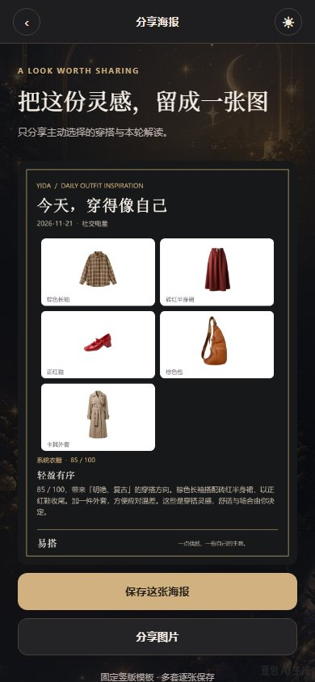
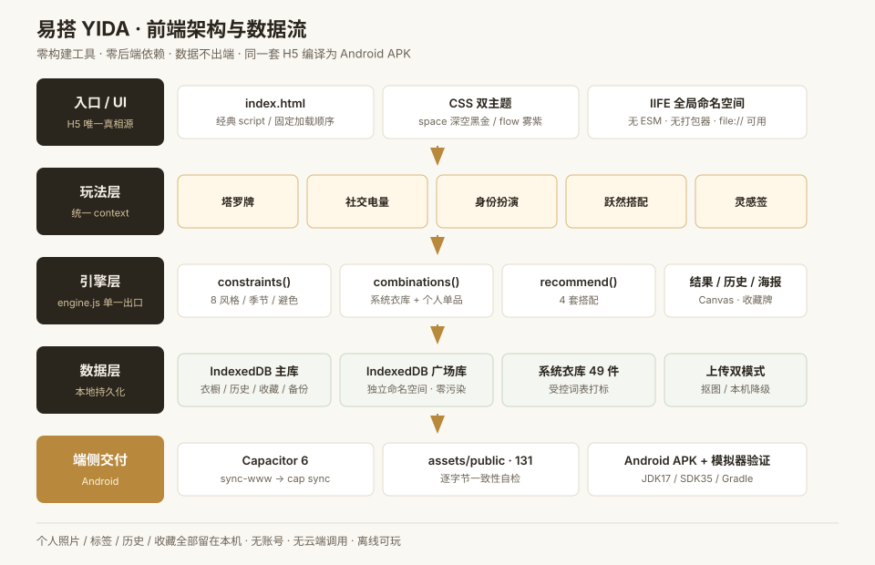

# 易搭 YIDA｜电子衣橱 × 穿搭灵感

> **Vanilla JS · Capacitor 6 · IndexedDB · 零构建工具 · 零后端依赖**
> 2026-11-21 收尾版工程快照。双击 `frontend/index.html` 即可运行，同一套代码也可编译为 Android APK。
>
> ✅ **本仓库当前维护版本**（易搭 YIDA · 2026-11-21）；历史迭代版本统一归档在 [`archive/`](../archive/README.md)，请勿混淆。
> 🚀 **在线预览**：https://ccccongggg.github.io/yida-wardrobe/frontend/ ｜ 全部预览方式见 [PREVIEW.md](../PREVIEW.md)

把「今天穿什么」变成一件轻松的小事：先用五种玩法收集当日状态，规则引擎从衣橱里组合出 4 套搭配，一键确认后进入历史、收藏与结果海报；另有微博式广场与个人主页。**个人数据只存在本机浏览器，不需要账号，也不上传云端。**

| 首页 · V8 金色夜空 | 微博式广场 | 搭配结果页 |
| :---: | :---: | :---: |
|  |  |  |

| Android 模拟器实拍 | 个人主页 | 结果海报 |
| :---: | :---: | :---: |
|  |  |  |

## 功能

| 模块 | 能力 | 实现要点 |
|---|---|---|
| 五种玩法 | 塔罗牌 / 社交电量 / 身份扮演 / 跃然搭配 / 灵感签 | 各自把用户输入映射为 `context`，统一交给引擎产出约束与推荐；结果页按玩法给出不同语义标签 |
| 推荐引擎 | 受控 8 风格词表、季节/来源过滤、避色规则、4 套组合 | `engine.constraints()` 统一出口；`words` 在数据源定义，被结果 / 历史 / 详情 / 海报 / 推荐理由 5 处消费 |
| 我的衣橱 | 49 件系统衣库 + 用户上传单品；品类 / 颜色 / 风格 / 季节标签 | 上传采用**双模式**：本地服务可用时走抠图与打标；App / 离线时降级为「保留原背景 + 手动核对标签」，元数据如实标注，绝不把原图伪装成 AI 结果 |
| 广场 | 图文动态、点赞 / 评论 / 收藏 / 转发 / 关注 / 删帖 / 看图 | 独立 `IndexedDB` + 独立 CSS 命名空间，与主应用零耦合 |
| 个人主页 | 动态 / 收藏 Tab、统计、他人主页、返回逻辑 | 与广场数据联动 |
| 记录与分享 | 历史、详情、塔罗牌收藏、结果海报 | Canvas 绘制海报；备份导出 / 恢复 / 清空 |
| 主题 | V8 深空黑金（默认）/ 流光雾紫 | `data-theme` 切换，启动时迁移老存档 |

## 架构



| 层 | 技术 | 关键文件 |
|---|---|---|
| 入口 / UI | 经典 `<script src>` + IIFE 全局命名空间，无 ESM、无打包器 | `frontend/index.html`、`frontend/css/v11/v8-skin.css` |
| 玩法 | 五玩法页面 + 数据源 | `frontend/js/v11/product.js`、`frontend/data/v11/gameplay-data.js` |
| 引擎 | 约束 → 组合 → 推荐 | `frontend/js/v11/engine.js` |
| 状态 | 双 IndexedDB 隔离、本地持久化、备份校验 | `yida-local-v11` / `yida-plaza-v1` |
| 端侧交付 | Capacitor 6 → WebView assets → Android APK | 见 [`../android/README.md`](../android/README.md) |

## 工程亮点

| 亮点 | 可验证结果 |
|---|---|
| 三轮独立自动化回归 | 78 + 12 + 28 项浏览器回归，**0 FAIL**；覆盖五玩法全链路、边界输入、备份校验、广场零污染（文件哈希比对） |
| `file://` 双击可用 | 规避 file 协议三禁：不用 ESM、启动不依赖 `fetch`、纹理走 data URI；离线与 HTTP 双协议验证通过 |
| 双库隔离 + 命名空间纪律 | 主应用与广场状态分离，新样式禁止定义 `.pl-*` / `.pf-*`，回归用哈希证明零污染 |
| 上传双模式与语义诚实 | 壳内不发必然 404 的请求；降级单品元数据写 `cut_ok:false / tag_ok:false`，UI 三处明示「未抠图、保留原背景、手动打标」 |
| 安卓三步重编与一致性自检 | `sync-www → cap sync → assembleDebug` 缺一步会「假成功」；132 条 assets，`product.js` 在源码 / www / 公开仓 / APK 四处逐字节一致 |
| 数据不出端 | 无账号体系、无云端调用；IndexedDB 支持完整备份导出与恢复 |

## 预览方式（先看这里）

| 方式 | 入口 |
|---|---|
| 在线（零安装，推荐） | **https://ccccongggg.github.io/yida-wardrobe/frontend/** |
| 离线双击 | `frontend/index.html`（无需任何服务） |
| 本地静态服务 | `cd frontend && python -m http.server 8790` → http://127.0.0.1:8790/ |
| 安卓端 | 见 [`../android/README.md`](../android/README.md)；**APK 安装包不在公开仓**（发布资产不公开） |

完整指南（3 分钟体验路线 / FAQ / 版本对照）：[`../PREVIEW.md`](../PREVIEW.md)。
> 在线与离线版**没有后端**：添加衣物走本机降级（不抠图、保留原背景、标签手动核对），UI 会明确提示，**属设计行为而非故障**。

## 本地运行

```bash
# 方式一：双击即可（离线可玩，不需要任何服务）
frontend/index.html

# 方式二：可选本地静态服务（便于手机同局域网访问）
cd frontend && python -m http.server 8790
# 打开 http://127.0.0.1:8790/
```

前端源码本身**不依赖后端**；可选的本地图像处理服务、AI 打标配置与发布签名均不在本公开仓库范围内。

## 目录

```
├── frontend/               # 完整可运行 H5（唯一真相源）
│   ├── index.html
│   ├── css/                # 主题、组件、玩法样式
│   ├── js/v11/             # product.js / engine.js / plaza.js
│   ├── data/v11/           # 系统衣库、塔罗规则、五玩法数据
│   └── assets/             # 演示素材
├── android/                # 安卓端工程说明（脱敏）
├── docs/
│   ├── architecture.svg    # 架构图
│   ├── ENGINEERING.md      # 本工程说明
│   ├── RESUME.md           # 简历可复制文案
│   └── screenshots/        # 效果截图
└── archive/                # 历史迭代版本归档（只读记录，不再维护）
```

## 边界说明

- 本仓库是**作品展示快照**：不含任何密钥、`.env`、发布 keystore 与签名配置、服务端实现、商业化方案或内部研发文档。
- 演示衣图与卡面素材仅用于本地效果展示，未声明商用授权。
- 本仓库用于作品展示，未授予开源许可；如需引用请注明出处。

想直接写进简历？见 [`RESUME.md`](RESUME.md) —— 含项目描述、量化 bullet 与面试口述稿。
